# Architecture Specification: txt

> Modeled after Sublime Text: High Performance, Offline-First Native Editor.

---

## 1. High-Level Architectural Diagram

```mermaid
graph TD
    subgraph Frontend["txt-gui (Native GPU UI)"]
        App["TxtEditorApp (State Machine)"]
        Palette["CommandPalette (Fuzzy Modal)"]
        Canvas["EditorView (Viewport Line & Minimap)"]
        Sidebar["Sidebar (Project Tree Explorer)"]
        Tabs["TabBar (Multi-buffer Strip)"]
        StatusBar["StatusBar (Metrics & Sync State)"]
    end

    subgraph Core["txt-core (Domain & Algorithms)"]
        Buffer["TextBuffer (B-Tree Rope Engine)"]
        Cursor["SelectionSet (Multi-Cursor & Selections)"]
        Fuzzy["FuzzyMatcher (Sublime Scoring Heuristics)"]
        Command["CommandRegistry (Actions & Shortcuts)"]
        Syntax["SyntaxHighlighter (Lexical Scanner)"]
        Transform["TextTransform (Sublime Case & Indents)"]
        Search["ProjectSearchEngine (4096-item Batches)"]
        Plugin["PluginManager (EventListener Hooks)"]
        LSP["LspClientState (JSON-RPC Wire Protocol)"]
        History["HistoryManager (Transaction Grouping)"]
        Memory["MemoryMetrics (Allocation Profiling)"]
    end

    subgraph Sync["txt-sync (Sync Subsystem)"]
        LockMgr["ConcurrencyLockManager<Uuid>"]
        Engine["SyncEngine (Dynamic Worker Lifecycle)"]
        CRDT["CrdtBufferState (Vector Clock & RGA Engine)"]
        LocalAdapter["LocalFilesystemAdapter (Atomic Shadow Journal)"]
        MemAdapter["MemorySyncAdapter (In-Memory Relay)"]
        CloudAdapter["CloudSyncAdapter (Offline Buffer Queue)"]
    end

    App --> Canvas
    App --> Palette
    App --> Sidebar
    App --> Tabs
    App --> StatusBar

    Canvas --> Buffer
    Canvas --> Cursor
    Canvas --> Syntax

    Palette --> Fuzzy
    Palette --> Command

    App --> Transform
    App --> Search
    App --> Plugin
    App --> LSP

    App --> Engine
    Engine --> LockMgr
    Engine --> CRDT
    Engine --> LocalAdapter
    Engine --> MemAdapter
    Engine --> CloudAdapter
```

---

## 2. Text Buffer & Memory Management

Sublime Text achieved legendary reputation through its custom buffer design:
1. **B-Tree Rope (`txt-core::buffer::TextBuffer`)**:
   - Backed by `ropey`, text is chunked into node leaves rather than stored in flat contiguous memory.
   - Insertions and deletions take $O(\log N)$ time regardless of file size (handling 100MB+ files seamlessly).
   - Fast line lookups (`char_to_line`, `line_to_char`) without linear scans.
2. **Direct Memory Metrics**:
   - `MemoryMetrics` tracks estimated heap allocations, node tree overhead, line counts, and history stack depths.
   - Visible to the user in the status bar in real time.

---

## 3. Sublime Text Fuzzy Matcher Heuristics

The fuzzy search engine (`txt-core::fuzzy::FuzzyMatcher`) implements Sublime Text's matching algorithm:
- **Character Subsequence Check**: Case-insensitive sequence validation.
- **Prefix Match Bonus**: +60 points for matches at the beginning of the string.
- **Word Boundary Bonus**: +45 points for matches following separators (`/`, `\`, `_`, `-`, `:`, `.`, space).
- **CamelCase Bonus**: +35 points for uppercase characters following lowercase characters.
- **Consecutive Match Bonus**: +50 points for contiguous characters.
- **Acronym Matching**: Enables abbreviations like `cp` to instantly match `Tools: Command Palette`.
- **Length Penalty**: Penalizes long candidates to favor concise exact matches.

---

## 4. Multi-Cursor & Selection Range Model

- Each selection (`Selection`) consists of an `anchor` (origin) and `head` (caret).
- `SelectionSet` maintains multiple cursors, automatically sorting and merging overlapping selections.
- Multi-cursor edits execute in descending order to prevent index drift, with transaction grouping for single-step undo.

---

## 5. Modular Synchronization & Concurrency Safety

The synchronization architecture (`txt-sync`) follows strict concurrency guardrails:
1. **`ConcurrencyLockManager<K>`**:
   - Shared document resources require serialized operations to prevent race conditions.
   - Acquires fine-grained locks per document ID (`Uuid`) during push and pull patch cycles.
2. **Pluggable Sync Adapters**:
   - `LocalFilesystemAdapter`: Writes atomic shadow journals to disk using temp files and atomic rename.
   - `MemorySyncAdapter`: Ultra-fast in-memory patch store for testing and local relay.
   - `CloudSyncAdapter`: Supports offline patch buffering and replaying when connectivity is restored.
3. **Dynamic Background Worker Lifecycle**:
   - The sync heartbeat worker starts dynamically when active clients increase from 0 to 1.
   - **Immediately shuts down and cleans up background threads when active clients reach 0**, preventing idle resource drain.

---

## 6. CRDT & Collaborative Conflict Resolution (`txt-sync::crdt`)

To support multi-device offline-first editing without data loss:
1. **Replicated Growable Array (RGA)**:
   - Each character insertion generates a `CrdtOp::Insert` linked to its left neighbor (`origin_left`).
   - Sibling insertions at identical offsets are deterministically ordered by `(lamport_timestamp, peer_id, id)`.
2. **Vector Clocks (`VectorClock`)**:
   - Tracks causality across distributed peers via component-wise maximum merge.
   - Identifies causal dependencies and holds out-of-order operations in `pending_ops` queues until prerequisites arrive.
3. **Tombstone Deletes**:
   - Deletions are tracked as tombstones. If a delete arrives prior to an insert due to network reordering, it is buffered and applied immediately upon the node's arrival.

---

## 7. Parallel Project Search Engine (`txt-core::search`)

Modeled directly after Sublime Text’s empirical disassembly (`parallel_for_task<...Li4096EE>`):
1. **4096-Item Batch Work Units**:
   - Discovered files are partitioned into chunked work units of 4,096 items.
   - Maximizes multicore thread saturation while avoiding scheduling overhead and cache thrashing.
2. **Low-Allocation Worker Execution**:
   - Worker threads reuse pre-allocated character and byte buffers across lines and files.
   - Header inspection rejects binary files instantly if null bytes (`0x00`) are encountered in the first 512 bytes.
3. **Throughput**:
   - Verified at >2,000,000 lines/second on standard multicore workstations.

---

## 8. Plugin & Language Server Protocol (LSP) Engine (`txt-core::plugin`, `txt-core::lsp`)

1. **Event Listener Plugin Architecture**:
   - Implements the `EventListener` trait with hooks: `on_modified`, `on_save`, and `on_query_completions`.
   - `PluginManager` broadcasts events to registered plugins using snapshot clone pointers to prevent deadlock.
2. **LSP Wire Framing & State Machine**:
   - Robust `LspFramingParser` parses stdio streams with `Content-Length: ...\r\n\r\n{...}` framing.
   - `LspClientState` tracks monotonic request IDs, diagnostic caches per file, and query completion/hover adapters.

